# FinSense — Kişisel ve Ortak Finans Yönetim Platformu (v1.0)

**FinSense**, **%100 yerel, gizlilik odaklı ve harici yapay zeka API'sine bağımlı olmayan** bir kişisel ve aile/ortak finans yönetim mobil uygulamasıdır. Bireylerin, çiftlerin ve ailelerin **Türk Lirası (`TRY` / `₺`)** bazında (çoklu para birimine hazır defter mimarisiyle) gelir, gider, taksit, bütçe, birikim hedefi ve yatırım portföylerini yönetmesini; banka ekstrelerini yerel olarak toplu içe aktarmasını, fişlerini **RapidOCR** ile dijitalleştirmesini ve **deterministik finansal koç** üzerinden anlık içgörüler almasını sağlar.

---

## Öne Çıkan Özellikler

- **Çift Çalışma Alanı (Kişisel Alan & Ortak Ev Bütçesi):** Kişisel finanslarınızı izole tutarken, ortak hane çalışma alanları oluşturup davet kodu ile üyeleri rol bazlı (`Owner`, `Admin`, `Contributor`, `Viewer`) yetkilendirebilirsiniz.
- **Cüzdan Yönetimi (Ekleme & Silme):** Nakit, Banka Hesabı, Kredi Kartı ve Birikim cüzdanları oluşturabilir, güncel bakiyelerinizi izleyebilir ve cüzdanları güvenli şekilde (geçmiş işlemler ve analizler bozulmadan, bağlı düzenli talimatlar pasifleştirilerek) silebilirsiniz.
- **Ay Seçici (`< Kasım 2026 >`):** Özet (Dashboard) ve Planlama & Analiz ekranlarında geçmiş ve gelecek aylar arasında serbestçe gezinerek aylık gelir, gider, tasarruf oranı, bütçe kullanımı, kategori dağılımı ve gelecek taksit yüklerinizi inceleyebilirsiniz.
- **Kredi Kartı / Gider Taksit Bölme (2–24 Taksit):** Gider eklerken `Peşin`, `2`, `3`, `6`, `9`, `12` (API tarafında `1–24`) taksit seçenekleriyle toplam tutarı kuruş hassasiyetinde otomatik aylara bölebilir, aylık taksit önizlemesini anında görebilirsiniz.
- **%100 Yerel Banka Ekstresi Toplu İçe Aktarma (PDF / Excel / CSV):** Harici sunucu veya API kullanmadan `.pdf`, `.xlsx` ve `.csv` banka ekstrelerini yerel olarak ayrıştırır; Türk markalarına göre (Migros, BİM, Starbucks, Spotify, Shell, Turkcell, Kira, Maaş vb.) otomatik kategorize eder, mevcut işlemlerle karşılaştırarak mükerrer (`Tekrar`) kayıtları işaretler ve tek tıkla cüzdana aktarır.
- **Düzenli İşlemler (Sabit Gelir / Gider):** Aylık maaş, kira, abonelik ve fatura talimatlarını süreli veya süresiz olarak otomatikleştirebilirsiniz.
- **Bütçeler & Tasarruf Hedefleri:** Genel veya kategori bazlı aylık bütçe limitleri, uyarı eşikleri ve cüzdana bağlı/manuel tasarruf hedefleri oluşturabilirsiniz.
- **Yatırım Portföyü (Varlık Kasası):** Altın, BIST, Kripto, Döviz ve Fon alımlarınızı lot bazında kaydedip güncel piyasa değerlerini ve kâr/zarar durumunuzu takip edebilirsiniz.
- **Yerel Fiş Tarayıcı (RapidOCR) & Deterministik Finansal Koç:** Harici LLM veya bulut OCR anahtarı gerektirmeden Türkçe fişleri tarar ve 10 matematiksel hesaplayıcı ile harcama/tasarruf analizi sunar.
- **Açık & Koyu Tema + Çoklu Dil:** Sistem, Açık ve Koyu tema desteği ile Türkçe (`tr-TR`) ve İngilizce (`en-US`) arayüz.

---

## Temel Mimari ve Teknoloji Yığını

| Katman | Teknoloji | Sorumluluk |
| :--- | :--- | :--- |
| **Backend Gateway ve Ana Defter** | **ASP.NET Core Web API (.NET 8 LTS)**, EF Core 8, C# 12, MediatR, FluentValidation | Tek halka açık API geçidi, kimlik doğrulama (JWT + dönen Refresh Token), çalışma alanı izolasyonu, `NUMERIC(19,4)` parasal defter, taksit bölme, %100 yerel PDF/Excel/CSV ekstre ayrıştırıcı, düzenli işlemler, yatırım portföyü değerleme ve PostgreSQL erişimi. |
| **Dahili Finansal Analiz ve OCR Servisi** | **Python 3.11+ & FastAPI**, Pydantic v2, `rapidocr-onnxruntime` | %100 yerel, harici API anahtarı gerektirmeyen durumsuz (stateless) servis; deterministik finans koçu ve yerel Türkçe fiş OCR ayrıştırıcısı. Doğrudan veritabanı erişimi yoktur. |
| **Mobil İstemci** | **React Native + TypeScript (Expo)**, Expo Router, `expo-secure-store`, `expo-document-picker`, `i18next` | Çoklu platform (iOS / Android / Web) mobil uygulama; koyu/açık tema, ay seçici, taksitli gider girişi, banka ekstresi önizleme/onay akışı, fiş doğrulama ve çalışma alanı geçişi. |
| **Ana Veritabanı** | **PostgreSQL 16** | Çalışma alanı öncelikli bileşik indeksleme, iyimser eşzamanlılık (`xmin`) ve `NUMERIC(19,4)` parasal hassasiyet sunan ACID uyumlu ilişkisel veritabanı. |

---

## Ekran Görüntüleri

<table>
  <tr>
    <td align="center">
      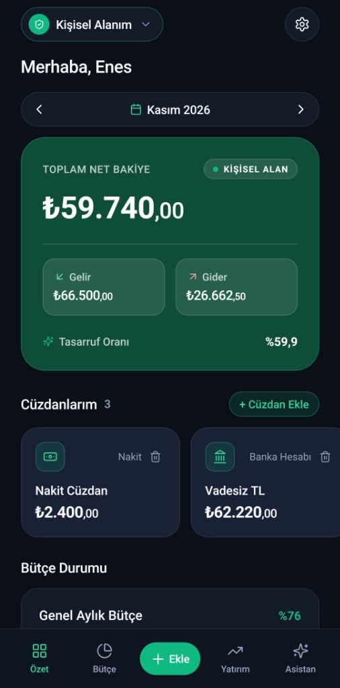
      <br /><sub><b>Özet — Koyu Tema</b></sub>
    </td>
    <td align="center">
      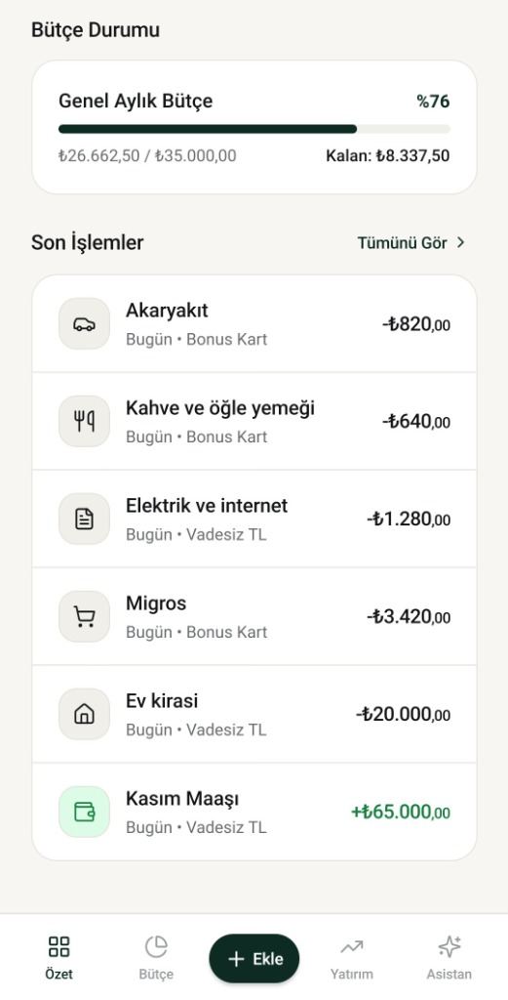
      <br /><sub><b>Özet — Bütçe ve Son İşlemler (Açık Tema)</b></sub>
    </td>
    <td align="center">
      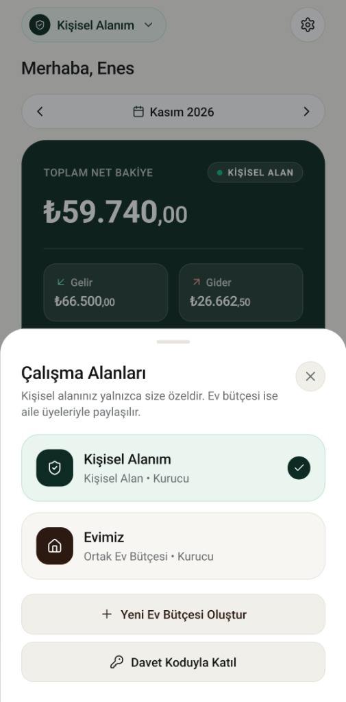
      <br /><sub><b>Çalışma Alanları (Kişisel &amp; Ortak Ev)</b></sub>
    </td>
  </tr>
  <tr>
    <td align="center">
      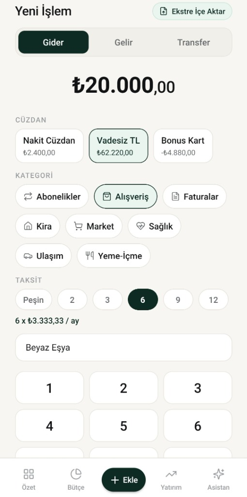
      <br /><sub><b>Yeni İşlem &amp; Taksit Bölme</b></sub>
    </td>
    <td align="center">
      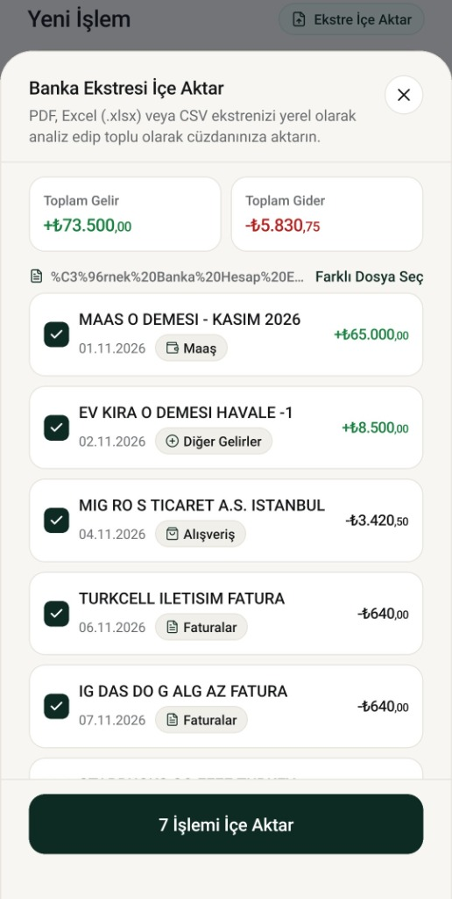
      <br /><sub><b>Banka Ekstresi İçe Aktarma (PDF/Excel/CSV)</b></sub>
    </td>
    <td align="center">
      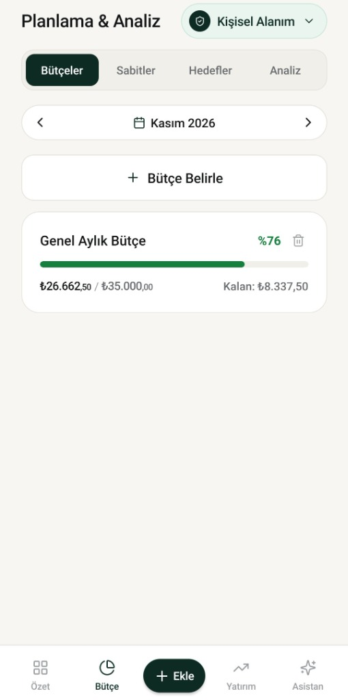
      <br /><sub><b>Planlama &amp; Analiz — Bütçeler</b></sub>
    </td>
  </tr>
  <tr>
    <td align="center">
      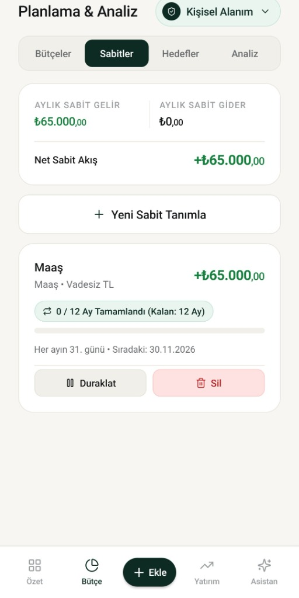
      <br /><sub><b>Planlama &amp; Analiz — Sabit İşlemler</b></sub>
    </td>
    <td align="center">
      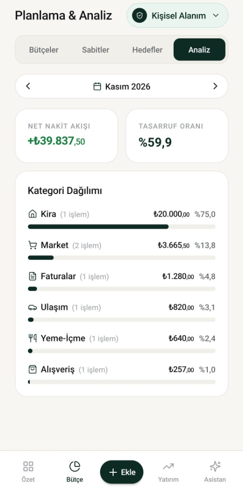
      <br /><sub><b>Planlama &amp; Analiz — Kategori Dağılımı</b></sub>
    </td>
    <td align="center">
      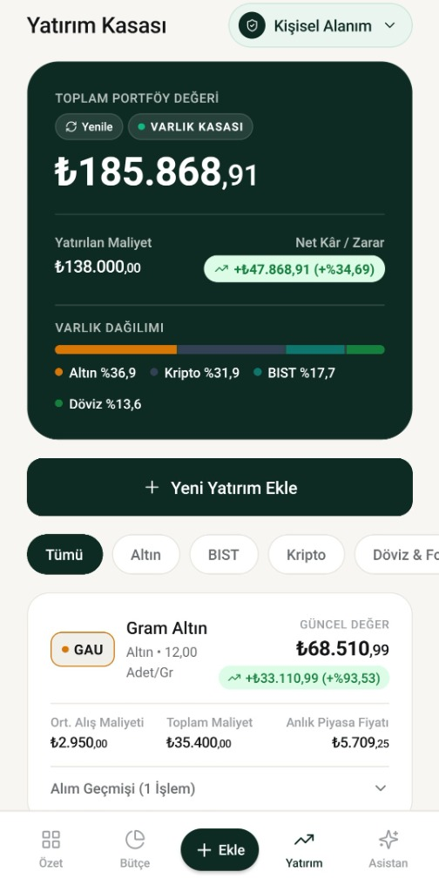
      <br /><sub><b>Yatırım Kasası — Portföy Özeti</b></sub>
    </td>
  </tr>
  <tr>
    <td align="center">
      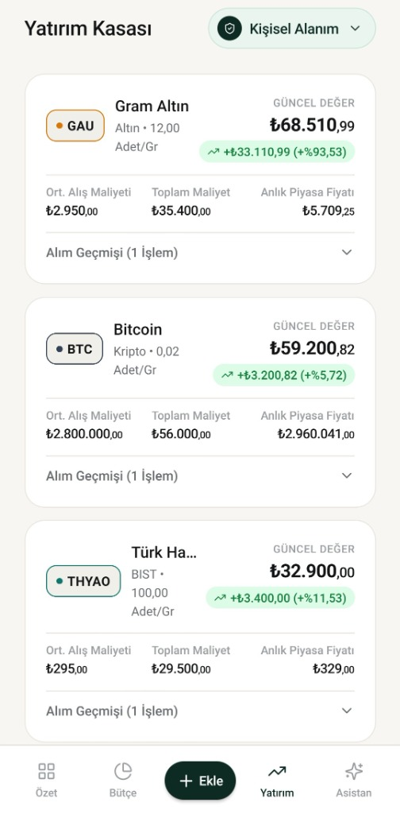
      <br /><sub><b>Yatırım Kasası — Varlık Listesi</b></sub>
    </td>
    <td align="center">
      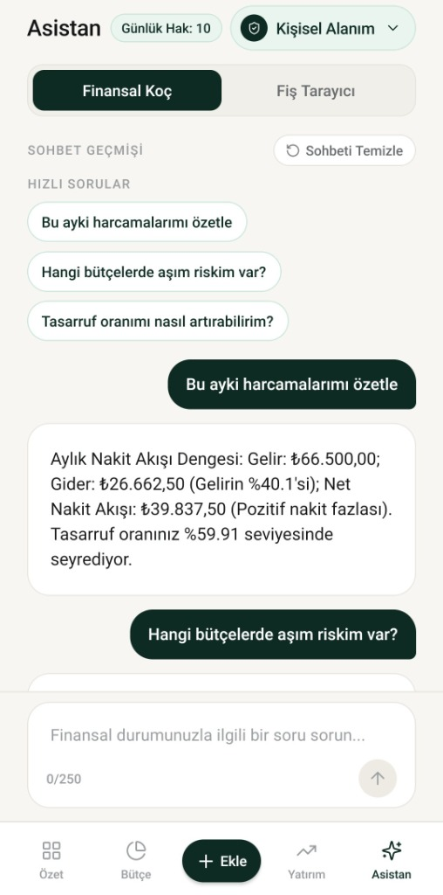
      <br /><sub><b>Asistan — Finansal Koç</b></sub>
    </td>
    <td align="center">
      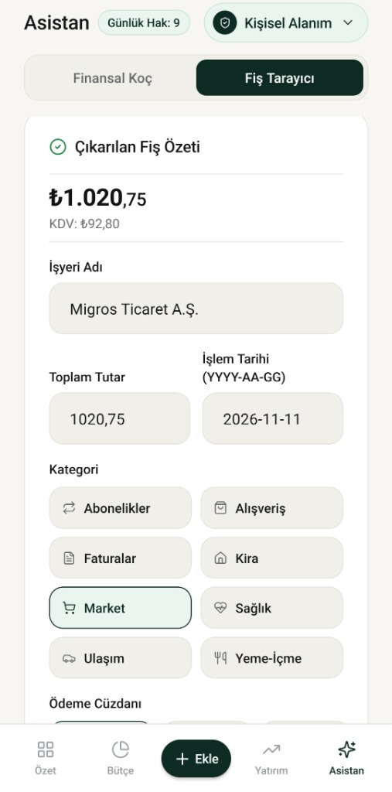
      <br /><sub><b>Asistan — Fiş Tarayıcı (OCR Özeti)</b></sub>
    </td>
  </tr>
  <tr>
    <td align="center" colspan="3">
      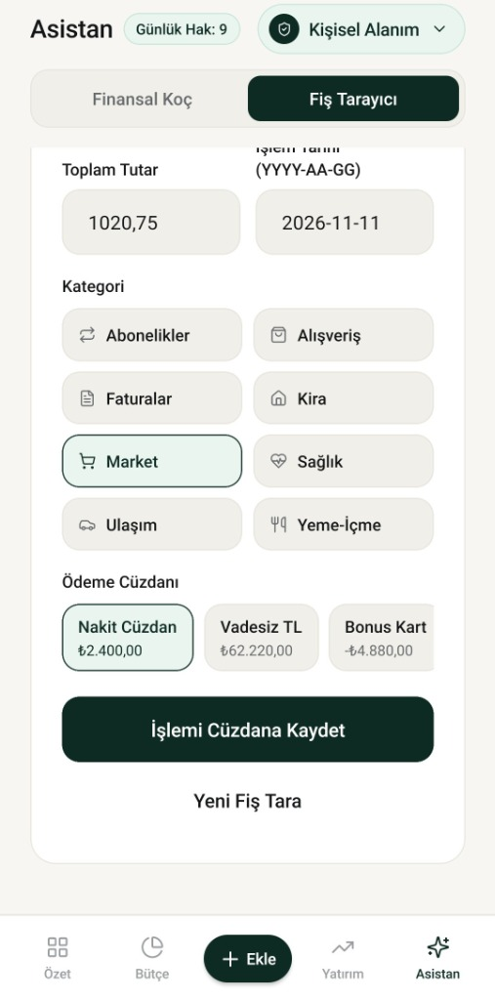
      <br /><sub><b>Asistan — Fiş Doğrulama &amp; Cüzdana Kayıt</b></sub>
    </td>
  </tr>
</table>

---

## Monorepo Klasör Yapısı

```text
FinSense/
├── docs/                       # Mimari, Ürün Spesifikasyonları ve Ekran Görüntüleri
│   ├── screenshots/            # Mobil Uygulama Ekran Görüntüleri
│   ├── PRD.md                  # Ürün Gereksinimleri Dokümanı (PRD)
│   ├── ARCHITECTURE.md         # Clean / Onion Mimari ve Servis Topolojisi
│   ├── DATABASE-DESIGN.md      # PostgreSQL Şeması, ER Diyagramı ve Çift Sayım Önleme Kuralları
│   ├── API-CONTRACTS.md        # Public REST ve Dahili FastAPI JSON Sözleşmeleri
│   └── AI-DESIGN.md            # Deterministik Finans Motoru, Güvenlik Kuralları ve Türkçe OCR Akışı
├── src/
│   ├── backend/                # .NET 8 LTS Clean Architecture Çözümü (FinSense.sln)
│   ├── ai-service/             # Python 3.11+ FastAPI Deterministik Finans & Yerel OCR Servisi
│   └── mobile/                 # React Native (Expo + TypeScript) Mobil Uygulama
├── .env.example                # Kök ortam değişkenleri şablonu (gerçek gizli anahtar içermez)
├── .gitignore                  # Monorepo yoksayma kuralları (.NET, Python, Node/Expo, Gizli/Ekstre Dosyaları)
└── docker-compose.yml          # Yerel PostgreSQL 16 altyapısı
```

---

## Teknik Dokümantasyon (`docs/`)

1. **[Ürün Gereksinimleri Dokümanı (`docs/PRD.md`)](./docs/PRD.md)** — Vizyon, kullanıcı profilleri, çift çalışma alanı rol yetkileri (`Owner`, `Admin`, `Contributor`, `Viewer`) ve yol haritası.
2. **[Sistem Mimarisi (`docs/ARCHITECTURE.md`)](./docs/ARCHITECTURE.md)** — Clean/Onion Architecture katman sorumlulukları, CQRS + MediatR hattı, `.NET <-> FastAPI` iletişimi ve Docker topolojisi.
3. **[Veritabanı Tasarımı (`docs/DATABASE-DESIGN.md`)](./docs/DATABASE-DESIGN.md)** — PostgreSQL şeması, ER diyagramı, transfer/kredi kartı çift sayım önleme kuralları ve bileşik indeksler.
4. **[API Sözleşmeleri (`docs/API-CONTRACTS.md`)](./docs/API-CONTRACTS.md)** — `/api/v1/workspaces/{wsId}/...` REST uç noktaları, RFC 7807 `ProblemDetails` hata yanıtları ve dahili FastAPI şemaları.
5. **[Deterministik Motor ve OCR Tasarımı (`docs/AI-DESIGN.md`)](./docs/AI-DESIGN.md)** — Deterministik SQL toplama hattı, PII anonimleştirme sınırları ve yerel RapidOCR fiş ayrıştırma akışı.

---

## Hızlı Başlangıç — Yerel Geliştirme Ortamı

### 1. Ortam Değişkenlerini Hazırlayın
Şablon dosyalarını kopyalayıp yerel değerlerinizi tanımlayın:

```powershell
Copy-Item .env.example .env
Copy-Item src/ai-service/.env.example src/ai-service/.env
Copy-Item src/mobile/.env.example src/mobile/.env
```

**Temel Ortam Değişkenleri:**
- **PostgreSQL (`docker-compose.yml`):** `POSTGRES_USER`, `POSTGRES_PASSWORD`, `POSTGRES_DB`, `POSTGRES_PORT`
- **Backend API (`.NET User Secrets` veya ortam değişkenleri):**
  - `ConnectionStrings__DefaultConnection` (PostgreSQL bağlantı dizesi)
  - `Jwt__SigningKey` (en az 32 byte uzunluğunda güvenli gizli anahtar)
  - `AiService__BaseUrl` (varsayılan: `http://localhost:8000`)
  - `AiService__InternalApiKey` (`src/ai-service` içindeki `INTERNAL_API_KEY` ile eşleşmelidir)
- **Finansal Analiz & OCR Servisi (`src/ai-service/.env`):** `INTERNAL_API_KEY`, `ENVIRONMENT`, `MAX_INPUT_CHARS`, `MAX_OUTPUT_CHARS`
- **Mobil İstemci (`src/mobile/.env`):** `EXPO_PUBLIC_API_URL` (Expo Go'da otomatik yerel ağ IP tespiti için `http://localhost:5000/api/v1` olarak veya boş bırakabilirsiniz)

### 2. PostgreSQL 16 Veritabanını Docker Compose ile Başlatın
```powershell
docker compose up -d
docker compose ps
```

### 3. Python Deterministik Analiz ve OCR Servisini Çalıştırın (`http://localhost:8000`)
```powershell
cd src/ai-service
python -m venv .venv
.\.venv\Scripts\Activate.ps1
pip install -r requirements.txt
uvicorn app.main:app --host 0.0.0.0 --port 8000 --reload
```

### 4. .NET 8 Backend API'yi Çalıştırın (`http://localhost:5000`)
```powershell
cd src/backend
dotnet user-secrets --project src/FinSense.Api set "ConnectionStrings:DefaultConnection" "Host=localhost;Port=5432;Database=finsense_db;Username=finsense_user;Password=change_me_local_pg_password"
dotnet user-secrets --project src/FinSense.Api set "Jwt:SigningKey" "replace-with-a-32-plus-byte-random-secret-key"
dotnet ef database update --project src/FinSense.Infrastructure --startup-project src/FinSense.Api
dotnet run --project src/FinSense.Api
```

### 5. Expo Mobil Uygulamasını Başlatın
```powershell
cd src/mobile
npm install
npm start
```

### 6. Test ve Doğrulama Komutları
```powershell
# .NET Backend Birim ve Entegrasyon Testleri (75 test)
dotnet test src/backend/FinSense.sln

# Python Deterministik Motor ve OCR Testleri (11 test)
cd src/ai-service
pytest tests -v

# Mobil TypeScript Tip Kontrolü ve Jest Testleri (7 test)
cd src/mobile
npm run typecheck
npm test
```

### 7. Altyapıyı Durdurun
```powershell
docker compose down
```
*(Yerel PostgreSQL verilerini tamamen sıfırlamak isterseniz yalnızca o durumda `-v` parametresini ekleyin.)*
