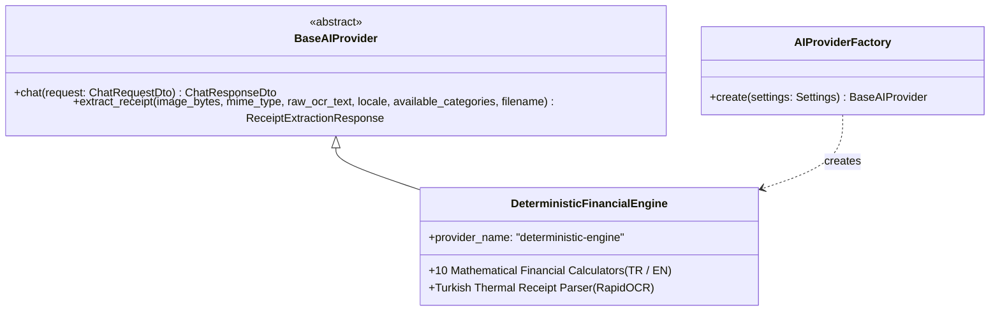

# FinSense — Deterministic Financial Engine & Local Receipt OCR Specification

**Version:** 2.0  
**Status:** Current Implementation  

---

## 1. Core Architectural Tenets

1. **100% Local, Deterministic & Zero-Hallucination:**
   - The Python FastAPI sidecar (`src/ai-service`) operates **completely offline and API-free**—no external LLM APIs, no cloud vision keys, and zero token costs.
   - All financial aggregations (`SUM`, `AVG`, `% change`, `Remaining Budget`, investment valuation, recurring obligations) are computed deterministically by **ASP.NET Core + PostgreSQL (`NUMERIC(19,4)`)** and passed as pre-computed ground-truth facts to the rule-based `DeterministicFinancialEngine`.
2. **Zero Database Access from Python:**
   - The Python FastAPI service (`ai-service`) is completely stateless and holds no database credentials. It can only process the single-workspace JSON context sent by ASP.NET Core for that specific request.
3. **Strict PII Anonymization:**
   - Emails, full names, phone numbers, IBANs, credit card numbers, and GPS EXIF coordinates are stripped before any payload is processed.

---

## 2. Engine Architecture (`src/ai-service`)

The Python FastAPI service exposes a clean `BaseAIProvider` interface backed by `DeterministicFinancialEngine` (aliased as `SmartLocalProvider` for backward compatibility) and local `rapidocr-onnxruntime` text extraction:



### Why 100% Local & Deterministic Matters
- **Zero External Dependencies or API Cost:** Runs identically in local development, Docker, and CI/CD with zero third-party API keys or rate limits.
- **Zero Hallucination:** Every currency amount, percentage, runway duration, and projection is computed directly via Python `Decimal` arithmetic from PostgreSQL ground-truth aggregates.
- **Privacy by Design:** User financial summaries and receipt photos never leave the host environment.

---

## 3. End-to-End Financial Assistant Pipeline

```mermaid
sequenceDiagram
    participant Mobile as React Native App
    participant API as ASP.NET Core API
    participant DB as PostgreSQL
    participant AI as Python FastAPI Service

    Mobile->>API: POST /api/v1/workspaces/{wsId}/ai/chat ("Bu ay markete ne kadar harcadık?")
    API->>DB: 1. Validate User Membership & Role in {wsId}
    API->>DB: 2. Execute Deterministic SQL Aggregations (.AsNoTracking, Type != Transfer)
    DB-->>API: Exact DECIMAL(19,4) Totals, Category Spend, Budget Alerts, Recurring & Investments
    API->>API: 3. Anonymize Context (Strip PII; map members to first name / alias)
    API->>AI: 4. POST /api/v1/internal/ai/chat (X-Internal-Api-Key + Question + JSON Context)
    AI->>AI: 5. Input Validation (max 250 chars) & Intent Routing across 10 Calculators
    AI-->>API: 6. Structured Pydantic v2 ChatResponseDto (TR/EN formatted)
    API-->>Mobile: 7. 200 OK (Formatted Answer, Highlighted Category & Suggested Action)
```

### 3.1 Supported Deterministic Calculators (TR & EN)
1. **Category-Specific Spend & Budget Status:** Exact spend, share %, transaction count, and remaining budget limit for any matched category.
2. **Month-End Burn Rate & Projection:** Daily burn rate based on current day of month and projected month-end surplus or deficit.
3. **Top Spending Categories Breakdown:** Ranked top expense categories and their percentage share of total monthly spend.
4. **Budget Alerts & Overspending Check:** Highlights categories at >= 80% warning or >= 100% exceeded thresholds.
5. **Savings & 50/30/20 Rule Simulation:** Calculates the 20% ideal savings target, gap, and impact of trimming 15% from the top category.
6. **Wallet Runway & Liquidity:** Computes months and days of runway from liquid balances against current monthly expense.
7. **Income vs. Expense Net Cash Flow:** Summarizes monthly income, expenses, expense ratio, net cash flow, and savings rate.
8. **Household Member Split:** Equal-share comparison and per-member spending breakdown in `Household` workspaces.
9. **Investment Portfolio & Wealth Status:** Total portfolio value, cost basis, unrealized P/L, and top holdings performance.
10. **Help & Capabilities Guide:** Lists supported queries in Turkish or English.

### 3.2 Context Anonymization & Input Guardrails
- **Excluded Fields:** `User.Email`, `User.Id`, `User.PasswordHash`, and sensitive account/card identifiers are never forwarded to the Python service.
- **Input Length Cap:** Questions exceeding `MAX_INPUT_CHARS` (default `250`) or empty inputs are cleanly rejected (`OFF_TOPIC_REJECTED`).
- **Turkish Formatting Enforcement:** Responses in `tr-TR` format currency as `₺1.234,56` and dates as `GG.AA.YYYY`.
- **No Regulated Investment Advice:** The engine provides deterministic spending, cash-flow, and portfolio status analytics only—not buy/sell financial advice.

---

## 4. Local Receipt OCR Pipeline (`RapidOCR`)

### 4.1 Preprocessing & Security Controls
- **Upload Size Limit:** Both ASP.NET Core (`AiController`) and FastAPI (`receipts.py`) enforce a strict **10 MB** maximum file size, rejecting larger payloads with HTTP `413 Payload Too Large`.
- **Image Sanitization:** Validates image format (`JPEG`, `PNG`, `WEBP`, `BMP`, `GIF`), applies EXIF orientation transposition, strips all EXIF/GPS metadata by re-encoding to RGB JPEG, and resizes the longest edge to `<= 1280px`.
- **Local OCR Extraction:** `rapidocr-onnxruntime` extracts raw text lines locally on CPU without calling external vision APIs.

### 4.2 Turkish Retail Receipt (`Fiş / Fatura`) Parsing Rules
- **Total Amount Keywords:** `TOPLAM`, `GENEL TOPLAM`, `TOP`, `TUTAR`, `ÖDENECEK`, with fallback to payment lines (`KREDİ`, `NAKİT`) and support for thermal `*` prefixes (e.g., `*128,95`) and multi-line labels.
- **Tax Keywords:** `KDV`, `TOPKDV`, `KDV TOPLAMI` (e.g., `*1,28`).
- **Number Normalization:** Converts Turkish decimal formatting (`1.420,75`) into canonical `Decimal("1420.75")` before returning to ASP.NET Core.
- **Merchant & Category Matching:** Recognizes major Turkish chains (e.g., *Migros, BİM, A101, ŞOK, CarrefourSA* -> `Market`; *Shell, Opet, Petrol Ofisi* -> `Ulaşım`) and matches against the workspace's `available_categories` list.

### 4.3 Graceful Degradation & Human-in-the-Loop Flow
Receipt scanning never blocks the user from logging an expense if an image is blurry or non-receipt content is uploaded:
1. **High Confidence (`confidence_score >= 0.75`):** Mobile UI pre-fills Merchant, Date, Total Amount, and Category for quick confirmation.
2. **Low Confidence (`0.0 < confidence_score < 0.75`):** Mobile UI pre-fills detected fields and highlights uncertain values so the user can review and edit before saving.
3. **Unreadable / Non-Receipt (`is_valid_receipt == false`):** Mobile UI prompts the user to enter the expense details manually without blocking the workflow.
