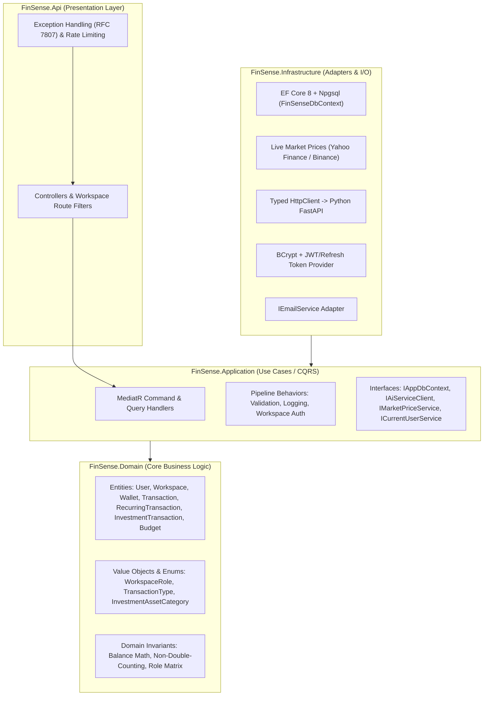
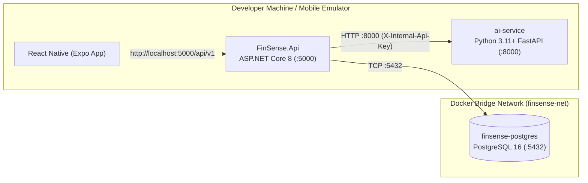

# FinSense — System Architecture Specification

**Version:** 2.0  
**Status:** Current Implementation  

---

## 1. Architectural Philosophy & Guiding Principles

FinSense follows **Clean / Onion Architecture** in the primary ASP.NET Core backend paired with a **Stateless Sidecar Pattern** for the Python deterministic financial & local OCR service.

1. **Single Public Gateway & Single Data Owner:** ASP.NET Core Web API (`.NET 8 LTS`) is the sole public entry point for the mobile client and the sole service with direct access to PostgreSQL.
2. **Dependency Rule:** Dependencies point strictly inward toward the `Domain` layer. The `Domain` and `Application` layers have zero dependencies on database drivers, HTTP clients, or external SDKs.
3. **CQRS with MediatR:** Commands (mutations) and Queries (reads) are segregated. Read queries enforce `.AsNoTracking()` and project directly to DTOs; Commands enforce domain invariants and execute atomically via Unit of Work / database transactions.
4. **Zero-Trust Workspace Isolation:** Every workspace-scoped operation validates membership and role permissions before application logic executes.
5. **Secrets Hygiene:** No credentials, connection strings, signing keys, or API keys are ever stored in `appsettings.json` or committed to Git. Local development uses **.NET User Secrets** and environment variables (`.env`).

---

## 2. Monorepo Directory & Solution Structure

```text
FinSense/
├── docs/                               # Architecture, PRD, Database, API & AI specifications
├── docker-compose.yml                  # Local PostgreSQL 16 infrastructure (optional FastAPI & ASP.NET services)
├── .env.example                        # Template for environment variables (no real secrets)
├── src/
│   ├── backend/                        # .NET 8 LTS Solution (FinSense.sln)
│   │   ├── src/
│   │   │   ├── FinSense.Domain/        # Enterprise entities, value objects, enums, domain exceptions
│   │   │   ├── FinSense.Application/   # CQRS Commands/Queries (MediatR), FluentValidation, interfaces
│   │   │   ├── FinSense.Infrastructure/# EF Core 8 (PostgreSQL), BCrypt/JWT, Market Price & FastAPI HTTP clients
│   │   │   └── FinSense.Api/           # Controllers/Endpoints, Workspace Auth filters, RFC 7807 middleware
│   │   └── tests/
│   │       ├── FinSense.Domain.UnitTests/
│   │       ├── FinSense.Application.UnitTests/
│   │       └── FinSense.Api.IntegrationTests/
│   │
│   ├── ai-service/                     # Python 3.11+ FastAPI Stateless Deterministic Financial & OCR Service
│   │   ├── app/
│   │   │   ├── routers/                # Internal routes (/api/v1/internal/ocr, /api/v1/internal/ai)
│   │   │   ├── security/               # X-Internal-Api-Key constant-time authentication
│   │   │   ├── providers/              # DeterministicFinancialEngine (10 calculators) & RapidOCR local extractor
│   │   │   └── schemas/                # Strict Pydantic v2 request/response models
│   │   └── tests/                      # pytest endpoint, auth, calculator & OCR unit tests
│   │
│   └── mobile/                         # React Native + TypeScript (Expo Managed Workflow)
│       ├── app/                        # Expo Router file-based navigation screens
│       ├── src/
│       │   ├── api/                    # Typed Axios/Fetch client + JWT refresh interceptor
│       │   ├── components/             # Reusable UI components
│       │   ├── context/                # Auth & Active Workspace state
│       │   ├── i18n/                   # Turkish (tr-TR) primary & English (en-US) translations
│       │   └── utils/                  # TRY currency & tr-TR date formatters
│       └── __tests__/                  # Jest + React Native Testing Library
```

---

## 3. ASP.NET Core Clean / Onion Architecture Layers



### 3.1 Layer Responsibilities

#### 1. `FinSense.Domain`
- **Zero external NuGet dependencies** (pure C# 12).
- Contains core aggregates and entities (`User`, `Workspace`, `WorkspaceMember`, `WorkspaceInvitation`, `Wallet`, `Category`, `Transaction`, `Budget`, `SavingsGoal`, `Receipt`, `AuditLog`).
- Enforces domain invariants:
  - Monetary values must use `decimal` (`NUMERIC(19,4)`).
  - Wallet balances can only be mutated through well-defined domain methods.
  - Permission checks mapped cleanly to `WorkspaceRole` (`Owner`, `Admin`, `Contributor`, `Viewer`).

#### 2. `FinSense.Application`
- Implements **CQRS via MediatR**:
  - **Commands:** Mutate state (`CreateTransactionCommand`, `CreateTransferCommand`, `ScanReceiptCommand`, `InviteHouseholdMemberCommand`). Validated via **FluentValidation** pipeline behavior and wrapped in an atomic database transaction.
  - **Queries:** Read-only operations (`GetWorkspaceDashboardQuery`, `GetTransactionsPageQuery`, `GetBudgetStatusQuery`). Queries **must** use `.AsNoTracking()` and project directly to response DTOs via `.Select(...)`.
- Defines ports/interfaces implemented by Infrastructure (`IFileStorageService`, `IAiOcrServiceClient`, `IEmailService`, `ITokenService`, `IDateTimeProvider`).

#### 3. `FinSense.Infrastructure`
- **Persistence:** `FinSenseDbContext` (EF Core 8 + `Npgsql.EntityFrameworkCore.PostgreSQL`), entity type configurations (`IEntityTypeConfiguration<T>`), migrations, and connection resilience.
- **Live Market Valuation:** `YahooBinanceMarketPriceService` fetches and caches (`IMemoryCache`) live BIST, crypto, gold, and forex TRY prices for the Investment Portfolio module.
- **Internal AI/OCR Client:** Resilient `HttpClient` (`AiServiceClient`) configured with `X-Internal-Api-Key` authentication and strict timeouts for calling the Python FastAPI sidecar.
- **Security & Email:** BCrypt password hashing, JWT generation, rotating SHA-256 Refresh Tokens, background `RecurringTransactionsHostedService`, and `DevelopmentLogEmailService`.

#### 4. `FinSense.Api`
- Thin HTTP presentation layer exposing versioned REST endpoints (`/api/v1/...`).
- **Workspace Authorization Filter / Policy:** Extracts `{wsId}` from route, verifies the current user's active membership and required `WorkspaceRole`, and populates `IWorkspaceContext` for the request lifetime.
- **Global Exception Handler:** Maps domain, validation, and authorization exceptions into standardized **RFC 7807 `ProblemDetails`** responses localized according to `Accept-Language` (`tr-TR` default, `en-US` fallback).

---

## 4. ASP.NET Core <-> Python FastAPI Internal Communication

The Python FastAPI service (`ai-service`) is an **internal stateless compute worker**:

1. **Network Isolation:** Runs inside the private Docker/VPC network (`http://ai-service:8000`). Its port is not exposed to public ingress in production.
2. **Service-to-Service Authentication:** Every request from ASP.NET Core includes the `X-Internal-Api-Key` header loaded from User Secrets / environment variables, validated by a FastAPI security dependency using constant-time comparison (`hmac.compare_digest`).
3. **100% Local Deterministic Engine & RapidOCR:**
   - Powered by `DeterministicFinancialEngine` (10 mathematical calculators for Turkish & English financial queries) and `rapidocr-onnxruntime` for local Turkish thermal receipt OCR.
   - Requires **zero external LLM API keys**, zero cloud vision calls, and has zero database access.

---

## 5. Local Development & Docker Topology

`docker-compose.yml` provides a reproducible local PostgreSQL 16 database environment:



### Services in `docker-compose.yml`
1. **`finsense-postgres` (`postgres:16-alpine`):** Persistent volume `postgres_data`, healthcheck via `pg_isready`, exposed on port `5432`.
2. **Optional Containerized Services:** Commented templates for `finsense-ai` (`:8000`) and `finsense-api` (`:5000`) are included in `docker-compose.yml` for future full-container deployment.
