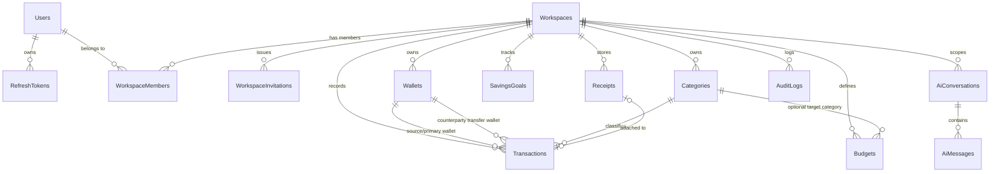

# FinSense — Database Design & Ledger Specification

**Version:** 1.0  
**Status:** Approved Baseline (Phase 0)  
**Database Engine:** PostgreSQL 16+  
**ORM:** Entity Framework Core 8 (`Npgsql.EntityFrameworkCore.PostgreSQL`)  

---

## 1. Core Database Design Principles

1. **Workspace-First Multi-Tenancy:**
   - Every financial and operational record (`Wallet`, `Category`, `Transaction`, `Budget`, `SavingsGoal`, `Receipt`, `AiConversation`, `AuditLog`) is owned by a single `Workspace` via a non-nullable `WorkspaceId` (`UUID`) foreign key.
   - A `Personal` workspace has exactly one member (`Role = Owner`). A `Household` workspace has 1 to $N$ members with explicit roles (`Owner`, `Admin`, `Contributor`, `Viewer`).
2. **Exact Monetary Precision (`NUMERIC(19,4)`):**
   - Every monetary column across all tables is defined as `NUMERIC(19,4)`.
   - `float`, `real`, and `double precision` are strictly forbidden.
3. **Multi-Currency Ready Schema:**
   - All monetary entities include `CurrencyCode CHAR(3) NOT NULL DEFAULT 'TRY'`.
   - `Transactions` include `OriginalAmount NUMERIC(19,4)`, `OriginalCurrencyCode CHAR(3)`, and `ExchangeRate NUMERIC(19,8)` (default `1.00000000` in MVP) to support future foreign-currency transactions without schema breaks.
4. **Non-Double-Counting Ledger Rules (Transfers & Credit Card Payments):**
   - **Inter-Wallet Transfers** and **Credit Card Bill Settlements** move money between two wallets within the same workspace. They **must never** inflate workspace-level Income or Expense totals. (Detailed in Section 4).
5. **Read Optimization with `.AsNoTracking()`:**
   - All EF Core Query Handlers (`IRequestHandler<TQuery, TResponse>`) must apply `.AsNoTracking()` and project directly to DTOs.
6. **Optimistic Concurrency & ACID Ledger Updates:**
   - `Wallets` and `Budgets` use PostgreSQL's system `xmin` column mapped as an EF Core concurrency token (`UseXminAsConcurrencyToken()`) alongside atomic database transactions when updating balances.

---

## 2. Entity-Relationship (ER) Diagram

---

## 3. Core Tables & Schema Specification

### 3.1 Identity & Workspace Tables

#### `users`
| Column | Type | Constraints | Description |
| :--- | :--- | :--- | :--- |
| `id` | `UUID` | `PK` | User unique identifier |
| `email` | `VARCHAR(256)` | `UNIQUE, NOT NULL` | Normalized lowercase email |
| `password_hash` | `VARCHAR(512)` | `NOT NULL` | Argon2id / BCrypt password hash |
| `display_name` | `VARCHAR(100)` | `NOT NULL` | User display name (e.g., first name / nickname) |
| `preferred_locale` | `VARCHAR(10)` | `NOT NULL DEFAULT 'tr-TR'` | `tr-TR` or `en-US` |
| `created_at_utc` | `TIMESTAMPTZ` | `NOT NULL` | Account creation timestamp |
| `updated_at_utc` | `TIMESTAMPTZ` | `NOT NULL` | Last profile update timestamp |

#### `refresh_tokens`
| Column | Type | Constraints | Description |
| :--- | :--- | :--- | :--- |
| `id` | `UUID` | `PK` | Token record ID |
| `user_id` | `UUID` | `FK -> users(id) ON DELETE CASCADE` | Owning user |
| `token_hash` | `VARCHAR(128)` | `UNIQUE, NOT NULL` | SHA-256 hash of refresh token |
| `token_family_id` | `UUID` | `NOT NULL` | Groups rotated tokens for reuse detection |
| `expires_at_utc` | `TIMESTAMPTZ` | `NOT NULL` | Expiration timestamp |
| `revoked_at_utc` | `TIMESTAMPTZ` | `NULL` | Populated when rotated or logged out |
| `replaced_by_token_hash` | `VARCHAR(128)` | `NULL` | Points to successor token hash |

#### `workspaces`
| Column | Type | Constraints | Description |
| :--- | :--- | :--- | :--- |
| `id` | `UUID` | `PK` | Workspace unique identifier |
| `name` | `VARCHAR(100)` | `NOT NULL` | e.g., `"Kişisel Alanım"` or `"Ev Bütçesi"` |
| `type` | `SMALLINT` | `NOT NULL` | `1 = Personal`, `2 = Household` |
| `default_currency` | `CHAR(3)` | `NOT NULL DEFAULT 'TRY'` | ISO 4217 currency code |
| `created_by_user_id` | `UUID` | `FK -> users(id) ON DELETE SET NULL` | Creator user reference |
| `created_at_utc` | `TIMESTAMPTZ` | `NOT NULL` | Creation timestamp |

#### `workspace_members`
| Column | Type | Constraints | Description |
| :--- | :--- | :--- | :--- |
| `id` | `UUID` | `PK` | Membership ID |
| `workspace_id` | `UUID` | `FK -> workspaces(id) ON DELETE CASCADE` | Target workspace |
| `user_id` | `UUID` | `FK -> users(id) ON DELETE CASCADE` | Member user (`UNIQUE(workspace_id, user_id)`) |
| `role` | `SMALLINT` | `NOT NULL` | `1 = Owner`, `2 = Admin`, `3 = Contributor`, `4 = Viewer` |
| `joined_at_utc` | `TIMESTAMPTZ` | `NOT NULL` | Timestamp when user joined |

#### `workspace_invitations`
| Column | Type | Constraints | Description |
| :--- | :--- | :--- | :--- |
| `id` | `UUID` | `PK` | Invitation ID |
| `workspace_id` | `UUID` | `FK -> workspaces(id) ON DELETE CASCADE` | Target Household Workspace |
| `invitation_code` | `VARCHAR(16)` | `UNIQUE, NOT NULL` | 8-character uppercase alphanumeric code (`A-Z0-9`) |
| `invited_email` | `VARCHAR(256)` | `NULL` | Optional target email address |
| `assigned_role` | `SMALLINT` | `NOT NULL` | Role granted upon acceptance (`Admin`, `Contributor`, `Viewer`) |
| `invited_by_user_id` | `UUID` | `FK -> users(id) ON DELETE CASCADE` | Inviter user ID |
| `expires_at_utc` | `TIMESTAMPTZ` | `NOT NULL` | Expiration timestamp (e.g., +48 hours) |
| `accepted_at_utc` | `TIMESTAMPTZ` | `NULL` | Timestamp when redeemed |
| `accepted_by_user_id` | `UUID` | `NULL` | User who redeemed the invitation |

---

### 3.2 Financial Ledger Tables

#### `wallets`
| Column | Type | Constraints | Description |
| :--- | :--- | :--- | :--- |
| `id` | `UUID` | `PK` | Wallet ID |
| `workspace_id` | `UUID` | `FK -> workspaces(id) ON DELETE CASCADE` | Owning workspace |
| `name` | `VARCHAR(100)` | `NOT NULL` | e.g., `"Nakit"`, `"Maaş Hesabı"`, `"Bonus Kredi Kartı"` |
| `type` | `SMALLINT` | `NOT NULL` | `1 = Cash`, `2 = BankAccount`, `3 = CreditCard`, `4 = Savings` |
| `currency_code` | `CHAR(3)` | `NOT NULL DEFAULT 'TRY'` | ISO 4217 code |
| `initial_balance` | `NUMERIC(19,4)` | `NOT NULL DEFAULT 0` | Starting balance when created |
| `current_balance` | `NUMERIC(19,4)` | `NOT NULL DEFAULT 0` | Current calculated balance (negative for CreditCard debt) |
| `credit_limit` | `NUMERIC(19,4)` | `NULL` | Optional credit limit (for `CreditCard` wallets) |
| `icon` | `VARCHAR(50)` | `NULL` | UI icon key |
| `color_hex` | `VARCHAR(9)` | `NULL` | UI color hex |
| `is_archived` | `BOOLEAN` | `NOT NULL DEFAULT FALSE` | Hides wallet from new transactions while keeping history |
| `is_deleted` | `BOOLEAN` | `NOT NULL DEFAULT FALSE` | Soft-delete flag |
| `xmin` | `XID` | `SYSTEM CONCURRENCY TOKEN` | Optimistic concurrency version |

> **Wallet Balance Mutation Rule:** `current_balance` cannot be arbitrarily overwritten via a direct `PUT` without auditability. If an authorized user updates a wallet's balance, the system either shifts `current_balance` by the `initial_balance` delta or records an explicit balance adjustment transaction.

#### `categories`
| Column | Type | Constraints | Description |
| :--- | :--- | :--- | :--- |
| `id` | `UUID` | `PK` | Category ID |
| `workspace_id` | `UUID` | `FK -> workspaces(id) ON DELETE CASCADE` | Owning workspace |
| `name_tr` | `VARCHAR(100)` | `NOT NULL` | Turkish display name (e.g., `"Market"`, `"Faturalar"`) |
| `name_en` | `VARCHAR(100)` | `NULL` | English display name (e.g., `"Groceries"`, `"Bills"`) |
| `type` | `SMALLINT` | `NOT NULL` | `1 = Income`, `2 = Expense` |
| `icon` | `VARCHAR(50)` | `NOT NULL` | Icon identifier |
| `color_hex` | `VARCHAR(9)` | `NOT NULL` | Hex color code |
| `is_system` | `BOOLEAN` | `NOT NULL DEFAULT FALSE` | Seeded default category |
| `is_deleted` | `BOOLEAN` | `NOT NULL DEFAULT FALSE` | Soft-delete flag |

> **System & Custom Category Lifecycle Rules:**
> - **System Categories (`is_system = TRUE`):** Seeded per workspace upon creation; cannot be modified (`PUT`) or deleted (`DELETE`).
> - **Custom Categories (`is_system = FALSE`):** When deleted, custom categories referenced by existing transactions are soft-deleted/archived (`is_deleted = TRUE`) so historical transaction category references and analytics remain intact while hiding the category from new transaction pickers.

#### `transactions`
| Column | Type | Constraints | Description |
| :--- | :--- | :--- | :--- |
| `id` | `UUID` | `PK` | Transaction ID |
| `workspace_id` | `UUID` | `FK -> workspaces(id) ON DELETE CASCADE` | Owning workspace |
| `wallet_id` | `UUID` | `FK -> wallets(id)` | Primary/source wallet |
| `counterparty_wallet_id` | `UUID` | `FK -> wallets(id) NULL` | Destination wallet (Required when `type = Transfer`) |
| `category_id` | `UUID` | `FK -> categories(id) NULL` | Required for `Income`/`Expense`, `NULL` for `Transfer` |
| `receipt_id` | `UUID` | `FK -> receipts(id) NULL` | Optional linked OCR receipt |
| `type` | `SMALLINT` | `NOT NULL` | `1 = Income`, `2 = Expense`, `3 = Transfer` |
| `amount` | `NUMERIC(19,4)` | `NOT NULL CHECK (amount > 0)` | Always positive; direction is determined by `type` |
| `currency_code` | `CHAR(3)` | `NOT NULL DEFAULT 'TRY'` | Wallet currency (`TRY`) |
| `original_amount` | `NUMERIC(19,4)` | `Not Null` | Defaults to `amount` in MVP |
| `original_currency_code` | `CHAR(3)` | `Not Null` | Defaults to `currency_code` in MVP |
| `exchange_rate` | `NUMERIC(19,8)` | `NOT NULL DEFAULT 1.0` | `1.00000000` in MVP |
| `transaction_date` | `DATE` | `NOT NULL` | Local calendar date of transaction (`Europe/Istanbul`) |
| `merchant_name` | `VARCHAR(200)` | `NULL` | Merchant or payee name (e.g., `"Migros"`, `"BİM"`) |
| `notes` | `VARCHAR(1000)` | `NULL` | Optional user notes |
| `created_by_user_id` | `UUID` | `FK -> users(id) ON DELETE SET NULL` | Member who logged the transaction |
| `paid_by_user_id` | `UUID` | `FK -> users(id) ON DELETE SET NULL` | Member who paid (defaults to `created_by_user_id`) |
| `idempotency_key` | `VARCHAR(100)` | `NULL` | Unique per `(workspace_id, idempotency_key)` |
| `is_deleted` | `BOOLEAN` | `NOT NULL DEFAULT FALSE` | Soft-delete flag |
| `deleted_at_utc` | `TIMESTAMPTZ` | `NULL` | Soft-delete timestamp |
| `created_at_utc` | `TIMESTAMPTZ` | `NOT NULL` | Record creation UTC timestamp |

---

### 3.3 Budgets, Savings Goals & Receipts Tables

#### `budgets`
| Column | Type | Constraints | Description |
| :--- | :--- | :--- | :--- |
| `id` | `UUID` | `PK` | Budget ID |
| `workspace_id` | `UUID` | `FK -> workspaces(id) ON DELETE CASCADE` | Owning workspace |
| `category_id` | `UUID` | `FK -> categories(id) NULL` | `NULL` = Overall Workspace Monthly Budget; Non-null = Category Budget |
| `year` | `SMALLINT` | `NOT NULL` | Calendar year (e.g., `2026`) |
| `month` | `SMALLINT` | `NOT NULL CHECK (month BETWEEN 1 AND 12)` | Calendar month (`1..12`) |
| `limit_amount` | `NUMERIC(19,4)` | `NOT NULL CHECK (limit_amount > 0)` | Monthly budget target |
| `currency_code` | `CHAR(3)` | `NOT NULL DEFAULT 'TRY'` | Currency code |
| `alert_threshold_percent` | `SMALLINT` | `NOT NULL DEFAULT 80` | Alert threshold (default `80%`) |
| `is_deleted` | `BOOLEAN` | `NOT NULL DEFAULT FALSE` | Soft-delete flag |

#### `savings_goals`
| Column | Type | Constraints | Description |
| :--- | :--- | :--- | :--- |
| `id` | `UUID` | `PK` | Savings goal ID |
| `workspace_id` | `UUID` | `FK -> workspaces(id) ON DELETE CASCADE` | Owning workspace |
| `linked_wallet_id` | `UUID` | `FK -> wallets(id) NULL` | Optional dedicated `Savings` wallet |
| `name` | `VARCHAR(150)` | `NOT NULL` | e.g., `"Tatil Fonu"`, `"Acil Durum Fonu"` |
| `target_amount` | `NUMERIC(19,4)` | `NOT NULL CHECK (target_amount > 0)` | Target savings amount |
| `current_amount` | `NUMERIC(19,4)` | `NOT NULL DEFAULT 0` | Current accumulated amount (manual when `linked_wallet_id IS NULL`) |
| `currency_code` | `CHAR(3)` | `NOT NULL DEFAULT 'TRY'` | Currency code |
| `target_date` | `DATE` | `NULL` | Optional target completion date |
| `is_deleted` | `BOOLEAN` | `NOT NULL DEFAULT FALSE` | Soft-delete flag |

> **Savings Goal Progress Rule:** If `linked_wallet_id` is set, the goal's effective progress dynamically reflects that linked wallet's `current_balance`. Otherwise (`linked_wallet_id IS NULL`), `current_amount` can be updated manually via `PUT`.

#### `receipts`
| Column | Type | Constraints | Description |
| :--- | :--- | :--- | :--- |
| `id` | `UUID` | `PK` | Receipt ID |
| `workspace_id` | `UUID` | `FK -> workspaces(id) ON DELETE CASCADE` | Owning workspace |
| `object_key` | `VARCHAR(512)` | `UNIQUE, NOT NULL` | Optional receipt reference key (reserved for future object storage) |
| `content_type` | `VARCHAR(50)` | `NOT NULL` | `image/jpeg`, `image/png`, `image/webp` |
| `file_size_bytes` | `BIGINT` | `NOT NULL` | File size in bytes |
| `status` | `SMALLINT` | `NOT NULL` | `1 = PendingConfirmation`, `2 = LinkedToTransaction`, `3 = MarkedForDeletion` |
| `extracted_merchant` | `VARCHAR(200)` | `NULL` | Raw OCR merchant draft |
| `extracted_date` | `DATE` | `NULL` | Raw OCR date draft |
| `extracted_total` | `NUMERIC(19,4)` | `NULL` | Raw OCR total amount draft |
| `extracted_tax` | `NUMERIC(19,4)` | `NULL` | Raw OCR KDV/tax draft |
| `confidence_score` | `NUMERIC(5,4)` | `NULL` | OCR confidence (`0.0000` to `1.0000`) |
| `uploaded_by_user_id` | `UUID` | `FK -> users(id) ON DELETE SET NULL` | User who uploaded the receipt |
| `created_at_utc` | `TIMESTAMPTZ` | `NOT NULL` | Upload timestamp |

> **Orphaned Pending Receipts Cleanup Rule:** Receipts remaining in `status = 1 (PendingConfirmation)` for more than **24 hours** (`created_at_utc < NOW() - INTERVAL '24 hours'`) without being linked to a confirmed transaction are automatically transitioned to `status = 3 (MarkedForDeletion)` and purged from Object Storage.

---

### 3.4 AI Conversations & Audit Log Tables

#### `ai_conversations`
| Column | Type | Constraints | Description |
| :--- | :--- | :--- | :--- |
| `id` | `UUID` | `PK` | Conversation ID |
| `workspace_id` | `UUID` | `FK -> workspaces(id) ON DELETE CASCADE` | Strictly scoped workspace |
| `user_id` | `UUID` | `FK -> users(id) ON DELETE CASCADE` | User who initiated the conversation |
| `title` | `VARCHAR(200)` | `NOT NULL` | Short conversation summary title |
| `created_at_utc` | `TIMESTAMPTZ` | `NOT NULL` | Creation timestamp |
| `updated_at_utc` | `TIMESTAMPTZ` | `NOT NULL` | Last message timestamp |

#### `ai_messages`
| Column | Type | Constraints | Description |
| :--- | :--- | :--- | :--- |
| `id` | `UUID` | `PK` | Message ID |
| `conversation_id` | `UUID` | `FK -> ai_conversations(id) ON DELETE CASCADE` | Parent conversation |
| `role` | `SMALLINT` | `NOT NULL` | `1 = User`, `2 = Assistant` |
| `content` | `TEXT` | `NOT NULL` | Message text |
| `referenced_metrics` | `JSONB` | `NULL` | Optional deterministic metric badges returned with assistant answer |
| `provider_used` | `VARCHAR(50)` | `NULL` | e.g., `"deterministic-engine"` |
| `created_at_utc` | `TIMESTAMPTZ` | `NOT NULL` | Message creation UTC timestamp |

#### `audit_logs`
| Column | Type | Constraints | Description |
| :--- | :--- | :--- | :--- |
| `id` | `UUID` | `PK` | Audit log entry ID |
| `workspace_id` | `UUID` | `FK -> workspaces(id) ON DELETE CASCADE` | Scoped workspace |
| `actor_user_id` | `UUID` | `FK -> users(id) ON DELETE SET NULL` | User who performed the action |
| `action_type` | `VARCHAR(100)` | `NOT NULL` | e.g., `"TransactionUpdated"`, `"WalletBalanceAdjusted"`, `"MemberRoleChanged"` |
| `entity_name` | `VARCHAR(100)` | `NOT NULL` | Target entity type (e.g., `"Transaction"`, `"Wallet"`, `"WorkspaceMember"`) |
| `entity_id` | `UUID` | `NOT NULL` | Target entity primary key |
| `old_values` | `JSONB` | `NULL` | Previous field values snapshot |
| `new_values` | `JSONB` | `NULL` | New field values snapshot |
| `created_at_utc` | `TIMESTAMPTZ` | `NOT NULL` | Immutable event UTC timestamp |

---

## 4. Non-Double-Counting Rules (Transfers & Credit Cards)

A common pitfall in personal finance apps is double-counting expenses when a user pays with a credit card and later pays off their credit card bill from their bank account, or transfers funds between wallets. FinSense enforces strict accounting rules:

### Rule 1: Credit Card Purchases (`Type = Expense`)
- When a user buys groceries (`₺1.000,00`) using a `CreditCard` wallet:
  1. A transaction is recorded with `Type = Expense`, `WalletId = CreditCardWalletId`, `CategoryId = Market`, `Amount = 1000.0000`.
  2. The `CreditCard` wallet's `current_balance` decreases by `1000.0000` (e.g., from `0.00` to `-1000.00`, representing `₺1.000,00` of debt).
  3. **Analytics & Budgets:** Because `Type = Expense`, this `₺1.000,00` is counted **immediately** on the `transaction_date` toward the workspace's Monthly Expenses and the `Market` category budget.

### Rule 2: Credit Card Bill Payment & Inter-Wallet Transfers (`Type = Transfer`)
- When the user later pays off their `CreditCard` bill (`₺1.000,00`) from their `BankAccount` wallet (or moves money from `BankAccount` to `Cash` or `Savings`):
  1. A single atomic transaction is recorded with `Type = Transfer`, `WalletId = BankAccountWalletId` (source), `CounterpartyWalletId = CreditCardWalletId` (destination), `CategoryId = NULL`, `Amount = 1000.0000`.
  2. `BankAccount.current_balance` decreases by `1000.0000`.
  3. `CreditCard.current_balance` increases by `1000.0000` (returning from `-1000.00` to `0.00`).
  4. **Analytics & Budgets:** Because `Type = Transfer`, all Cash Flow, Category Breakdown, Budget Utilization, and AI Spending Queries filter by `WHERE type IN (Income, Expense) AND is_deleted = FALSE`. Thus, paying off a credit card or moving money to a savings wallet **never double-counts as an expense or income**.

---

## 5. Indexing Strategy

Every query in FinSense filters by `workspace_id` first. The following composite indexes are mandatory:

1. **`IX_transactions_workspace_date_type`**
   - `CREATE INDEX IX_transactions_workspace_date_type ON transactions (workspace_id, transaction_date DESC, type) WHERE is_deleted = FALSE;`
   - *Purpose:* Powers the transaction feed, monthly cash flow summaries, and date-range analytics with an index-only or fast bitmap scan.
2. **`IX_transactions_workspace_category_date`**
   - `CREATE INDEX IX_transactions_workspace_category_date ON transactions (workspace_id, category_id, transaction_date DESC) WHERE is_deleted = FALSE AND type = 2;`
   - *Purpose:* Powers real-time budget utilization (`Spent / Limit`) and category pie charts.
3. **`IX_transactions_workspace_idempotency`**
   - `CREATE UNIQUE INDEX IX_transactions_workspace_idempotency ON transactions (workspace_id, idempotency_key) WHERE idempotency_key IS NOT NULL;`
   - *Purpose:* Prevents duplicate transactions on mobile network retries.
4. **`IX_workspace_members_workspace_user`**
   - `CREATE UNIQUE INDEX IX_workspace_members_workspace_user ON workspace_members (workspace_id, user_id);`
   - *Purpose:* $O(1)$ lookup for the Workspace Authorization Filter on every API request.
5. **`IX_budgets_workspace_year_month_category`**
   - `CREATE UNIQUE INDEX IX_budgets_workspace_year_month_category ON budgets (workspace_id, year, month, COALESCE(category_id, '00000000-0000-0000-0000-000000000000')) WHERE is_deleted = FALSE;`
   - *Purpose:* Prevents duplicate active monthly budgets for the same category in a workspace.
