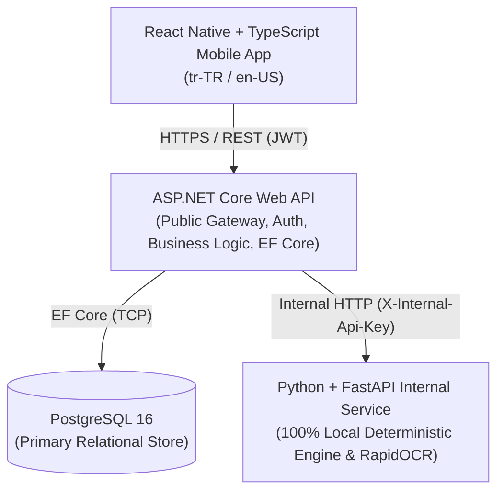

# FinSense — Product Requirements Document (PRD) & Architecture Specification

**Version:** 1.0  
**Status:** Approved (Phase 0 Baseline)  
**Primary Language / Locale:** Turkish (`tr-TR`, Localization-ready for `en-US`)  
**Default Currency (MVP):** Turkish Lira (`TRY` / `₺`)  

---

## 1. Executive Summary & Product Vision

**FinSense** is an AI-powered personal and shared household finance management mobile application. It enables individuals, couples, and families to track income and expenses effortlessly, manage personal and shared budgets, digitize paper receipts via OCR, and gain actionable, trustworthy financial insights through a conversational AI assistant.

### Core Value Proposition
1. **Strict Privacy with Seamless Sharing:** Users maintain a completely private **Personal Space** alongside one or more collaborative **Household Workspaces**. Personal financial data never leaks into shared spaces—neither in the UI nor through AI responses.
2. **Frictionless Expense Entry:** Combines fast manual logging with an intelligent **Receipt OCR Pipeline** tailored for Turkish retail receipts (fiş/fatura), featuring human-in-the-loop verification.
3. **Deterministic Financial Intelligence:** Combines a 100% local, API-free deterministic financial engine with PostgreSQL aggregations executed by the backend—eliminating arithmetic hallucinations while keeping personal identity data anonymized.

---

## 2. Target Users & Personas

| Persona | Description | Primary Goals | Key Pain Points |
| :--- | :--- | :--- | :--- |
| **Individual Professional (Bireysel Kullanıcı)** | Salaried employee or freelancer managing personal accounts, credit/debit wallets, and monthly savings goals. | Track where salary goes, curb impulse spending, and stick to monthly category limits. | Manual entry feels tedious; loses track of cash/card receipts; spreadsheet tracking is unsustainable on mobile. |
| **Partner / Couple (Çift / Eş)** | Two partners sharing rent, bills, and grocery budgets while keeping personal discretionary accounts private. | Maintain transparency on joint household expenses without surveilling each other's personal spending. | Existing apps either force 100% joint visibility or lack shared budgeting altogether. |
| **Family Household Manager (Aile Bütçesi Yöneticisi)** | Head of household coordinating shared family expenses with spouse and family members. | Categorize household receipts quickly, monitor monthly burn rate, and ask simple questions about spending trends. | Paper receipts pile up; difficult to see who spent what from shared household funds. |

---

## 3. Workspace Model, User Roles & Permissions

### 3.1 Dual-Space Isolation Model
Every registered user automatically receives a private **Personal Workspace** (`WorkspaceType = Personal`). In addition, users can create or be invited to **Household Workspaces** (`WorkspaceType = Household`).
- **Rule of Strict Isolation:** Resources (wallets, transactions, budgets, savings goals, receipts, AI chats) belong to **exactly one workspace**.
- Personal Space resources are accessible **only** to the owning user.
- Household Workspace resources are accessible to active members of that household according to their role.
- AI context is strictly scoped to a single active workspace context per query (or authorized aggregates explicitly requested by the user across spaces they personally have permission to read).

### 3.2 Household Roles & Permission Matrix

| Capability | Personal Owner (Personal Space) | Household Owner (Kurucu) | Household Admin / Partner (Yönetici) | Household Contributor (Üye) | Household Viewer (Gözlemci) |
| :--- | :---: | :---: | :---: | :---: | :---: |
| View workspace wallets, transactions & budgets | Yes | Yes | Yes | Yes | Yes |
| View receipt images attached to workspace transactions | Yes | Yes | Yes | Yes | Yes |
| Create / edit / delete own transactions & receipts | Yes | Yes | Yes | Yes | No |
| Edit / delete *other members'* transactions | N/A | Yes | Yes | No | No |
| Create / edit / archive wallets | Yes | Yes | Yes | No | No |
| Create / edit / delete budgets & savings goals | Yes | Yes | Yes | No | No |
| Query AI Assistant within workspace scope | Yes | Yes | Yes | Yes | Yes |
| Invite / remove members & change member roles | N/A | Yes | Yes (except Owner) | No | No |
| Delete entire Household Workspace | N/A | Yes | No | No | No |

---

## 4. Functional Requirements (FR)

### 4.1 Identity & Access Management (`FR-AUTH`)
- **FR-AUTH-01 (Registration):** Users can register using email, password, and display name. Passwords must meet complexity requirements and be hashed using Argon2id or bcrypt.
- **FR-AUTH-02 (Authentication & Token Lifecycle):** Login issues a short-lived JWT Access Token (e.g., 15 minutes) and a cryptographically random, rotating Refresh Token stored securely on device (`SecureStore`/Keychain) and hashed in PostgreSQL.
- **FR-AUTH-03 (Session Revocation):** Users can log out of the current device or revoke all active sessions (e.g., on password reset).
- **FR-AUTH-04 (Profile & Preferences):** Users can manage their display name, preferred language (`tr-TR` default, `en-US` supported), and notification preferences.
- **FR-AUTH-05 (Automatic Personal Space Provisioning):** Upon registration, the backend atomically creates the user's `Personal` workspace and seeds default system categories (localized in Turkish & English).

### 4.2 Workspace & Household Collaboration (`FR-WS`)
- **FR-WS-01 (Workspace Switching):** Users can switch active context between their Personal Space and any Household Workspace they belong to.
- **FR-WS-02 (Household Creation):** Any authenticated user can create a Household Workspace and becomes its `Owner`.
- **FR-WS-03 (Member Invitations):** Household Owners/Admins can invite users primarily via an in-app, time-limited 8-character alphanumeric Invitation Code (`A-Z0-9`), assigning an initial role (`Admin`, `Contributor`, `Viewer`), alongside an `IEmailService` abstraction for optional email invitations.
- **FR-WS-04 (Membership Management):** Owners/Admins can update member roles or remove members. Any member (except the sole Owner) can leave a household at any time.
- **FR-WS-05 (Member Attribution):** Every transaction created in a Household Workspace records `CreatedByUserId` (and optional `PaidByUserId`) so members can see who logged or paid for an expense.

### 4.3 Wallet & Account Management (`FR-WAL`)
- **FR-WAL-01 (Wallet CRUD):** Authorized users can create, update, or archive wallets within a workspace (e.g., *Nakit*, *Maaş Hesabı*, *Kredi Kartı*, *Ortak Ev Hesabı*).
- **FR-WAL-02 (Wallet Attributes):** Each wallet defines a name, type (`Cash`, `BankAccount`, `CreditCard`, `Savings`), currency code (MVP default: `TRY`, stored as ISO 4217 3-letter code), initial balance, and icon/color metadata.
- **FR-WAL-03 (Balance Integrity):** Wallet balances are maintained consistently whenever transactions are created, modified, or soft-deleted, backed by atomic database transactions.
- **FR-WAL-04 (Inter-Wallet Transfers):** Users can record transfers between two wallets within the same workspace without inflating income or expense totals.

### 4.4 Categories, Transactions & Ledger Engine (`FR-TX`)
- **FR-TX-01 (System & Custom Categories):** FinSense provides localized system categories (e.g., *Market*, *Faturalar*, *Kira*, *Ulaşım*, *Yeme-İçme*, *Maaş*) and allows workspaces to define custom categories (`Income` or `Expense`).
- **FR-TX-02 (Transaction Logging):** Users can create, edit, and delete transactions with: `WorkspaceId`, `WalletId`, `CategoryId`, `Type` (`Income`, `Expense`, `Transfer`), `Amount` (`DECIMAL(19,4)`), `Currency` (`TRY`), `TransactionDate`, `MerchantName` (optional), `Notes` (optional), and `Tags` (optional).
- **FR-TX-03 (Filtering & Search):** Users can filter transactions by date range, wallet, category, member (in households), transaction type, amount range, and text search on merchant/notes.
- **FR-TX-04 (Recurring Transactions - Phase 2):** Users can define recurring templates (monthly rent, subscriptions) that either auto-post or prompt for confirmation.

### 4.5 Budgeting & Savings Goals (`FR-BUD`)
- **FR-BUD-01 (Monthly Budgets):** Users (Personal Owner or Household Owner/Admin) can set monthly spending budgets per workspace—either overall or tied to specific expense categories.
- **FR-BUD-02 (Budget Progress & Threshold Alerts):** The system calculates real-time budget utilization (`Spent / Limit %`) and flags warning thresholds (e.g., 80% warning, 100% exceeded).
- **FR-BUD-03 (Savings Goals):** Workspaces can define savings goals with a target amount (`TRY`), target date, and current saved progress, tracked via manual contributions or linked savings wallets.

### 4.6 Receipt OCR & Object Storage Pipeline (`FR-OCR`)
- **FR-OCR-01 (Receipt Upload & Validation):** Users can capture a photo or select an image from their gallery (`JPEG`, `PNG`, `WEBP`, up to 10 MB). The ASP.NET Core API and FastAPI sidecar validate the file format and size limit (`<= 10 MB`, returning HTTP `413` if exceeded).
- **FR-OCR-02 (Local OCR Extraction Request):** Receipt images are stripped of EXIF metadata and processed locally via `rapidocr-onnxruntime` inside the stateless Python FastAPI OCR service (zero external vision APIs, zero database access), extracting structured fields:
  - `MerchantName` (İşyeri Adı)
  - `TransactionDate` (Tarih / Saat)
  - `TotalAmount` (Toplam Tutar - TRY)
  - `TaxAmount` (KDV Tutarı - optional)
  - `SuggestedCategory` (matched against workspace categories)
  - `LineItems` (optional item list)
  - `ConfidenceScore` (0.0–1.0)
- **FR-OCR-03 (Human-in-the-Loop Verification):** OCR extraction **never** commits a transaction silently. It returns a draft payload to the mobile app, pre-filling the transaction creation screen so the user can verify or edit fields before saving.
- **FR-OCR-04 (Receipt Image Viewing):** Authorized workspace members can view the original receipt image associated with a transaction via short-lived, authenticated pre-signed URLs (or an authenticated media proxy endpoint).

### 4.7 Analytics & Reporting (`FR-ANL`)
- **FR-ANL-01 (Cash Flow Summary):** Displays total income, total expenses, and net balance for a selected period (week, month, custom range) within the active workspace.
- **FR-ANL-02 (Category Breakdown):** Aggregates spending by category (amount and percentage of total spend) for pie/bar chart visualization.
- **FR-ANL-03 (Spending Trends):** Compares current month spending against previous months and highlights top merchants and categories.
- **FR-ANL-04 (Household Member Breakdown):** In Household Workspaces, summarizes contributions and expenses logged per member.

### 4.8 AI Financial Insights & Conversational Assistant (`FR-AI`)
- **FR-AI-01 (Proactive Financial Insights):** Generates periodic or on-demand structured insights for the active workspace (e.g., *"Market harcamalarınız geçen aya göre %24 arttı"*, unusual spending spikes, budget burn-rate warnings) based on deterministic SQL aggregations summarized by the AI service.
- **FR-AI-02 (Conversational Q&A Assistant):** Users can ask natural-language questions in Turkish (or English) about their finances (e.g., *"Geçen ay markete ne kadar harcadım?"*, *"Bu ay bütçemde ne kadar yer kaldı?"*).
- **FR-AI-03 (Deterministic Ground-Truth Answering):** All numerical figures in assistant responses **must** come from deterministic queries executed by ASP.NET Core against PostgreSQL and verified `Decimal` calculations—never from ungrounded guesswork.
- **FR-AI-04 (Strict Workspace & Role Scoping):** An AI conversation always runs in an explicit workspace context validated by ASP.NET Core. Household members can never query another member's Personal Space via the AI assistant.

---

## 5. Non-Functional Requirements (NFR)

1. **Localization & Formatting (`NFR-LOC`):**
   - Primary UI, system categories, error messages, and AI responses default to **Turkish (`tr-TR`)**.
   - Architecture uses localization resource dictionaries (`i18n` on mobile, resource/localization files on backend) to support seamless addition of English (`en-US`).
   - Formatting conventions for `tr-TR`: Dates (`DD.MM.YYYY`), numbers (`1.234,56`), currency (`₺1.234,56` or `1.234,56 TL`).
2. **Performance & Latency (`NFR-PERF`):**
   - Standard CRUD & dashboard API endpoints: `p95 < 300ms`.
   - Receipt OCR extraction pipeline: `p95 < 6 seconds`.
   - AI Assistant response time: `p95 < 5 seconds` (or streamed response).
3. **Monetary Precision (`NFR-PREC`):**
   - All financial figures are stored as `NUMERIC(19,4)` in PostgreSQL, processed as `decimal` in C# and `Decimal` in Python, and serialized as decimal strings or exact numbers in JSON contracts. Floating-point types (`float`/`double`) are strictly prohibited for money.
4. **Connectivity (`NFR-NET`):**
   - Active internet connection is required for MVP. The mobile app must gracefully display network error states and prevent duplicate submissions via idempotency keys on mutating requests.
5. **Maintainability & Clean Architecture (`NFR-ARCH`):**
   - Strict separation of concerns in ASP.NET Core (Domain, Application, Infrastructure, API layers) with high unit and integration testability.
6. **Auditability (`NFR-AUD`):**
   - All mutating operations in Household Workspaces (transaction edits/deletions, wallet balance adjustments, member role changes) are recorded in an immutable `AuditLog` table.

---

## 6. Core User Journeys

### Journey 1: Onboarding & First Personal Expense
1. User registers an account (`FR-AUTH-01`).
2. Backend automatically provisions their **Personal Space** with default Turkish categories and prompts the user to create their first wallet (e.g., *Vadesiz Hesap - ₺25.000,00*).
3. User logs a manual expense (*Market - ₺850,50*) and immediately sees their updated wallet balance and monthly spending chart.

### Journey 2: Receipt Scanning with OCR Verification
1. User taps **"Fiş Tara" (Scan Receipt)** in the mobile app and snaps a photo of a supermarket receipt.
2. App uploads the image to ASP.NET Core (`POST /api/v1/workspaces/{wsId}/receipts/scan`).
3. ASP.NET Core stores the image in Object Storage, records a `Pending` receipt record, and calls the internal Python FastAPI `/internal/v1/ocr/extract` endpoint.
4. Python service extracts Merchant (*Migros*), Date (*10.11.2026*), Total (*₺1.420,75*), and suggested category (*Market*).
5. Mobile app opens the pre-filled Transaction Form alongside a thumbnail of the receipt.
6. User verifies the amount, selects the wallet, and taps **Onayla ve Kaydet (Confirm & Save)** (`POST /api/v1/workspaces/{wsId}/transactions`).

### Journey 3: Creating a Household Workspace & Shared Budget
1. User A creates a Household Workspace named *"Ev Bütçesi"* (`FR-WS-02`).
2. User A creates a shared wallet (*Ortak Ev Kartı*) and a monthly budget (*Market & Mutfak: ₺15.000,00*).
3. User A invites Partner (User B) as `Admin` (`FR-WS-03`).
4. User B accepts the invite, switches workspace context to *"Ev Bütçesi"*, and logs a grocery receipt of ₺2.000,00.
5. Both User A and User B see the updated household budget (*₺2.000 / ₺15.000 - %13,3*) and who logged the transaction, while User A's and User B's Personal Spaces remain 100% private to each individual.

### Journey 4: Asking the AI Assistant a Financial Question
1. While in *"Ev Bütçesi"*, User B asks: *"Bu ay markete toplam ne kadar harcadık ve bütçemizden ne kadar kaldı?"*
2. Mobile app sends `POST /api/v1/workspaces/{wsId}/ai/chat`.
3. ASP.NET Core verifies User B is an active member of `wsId`, strips any PII, and orchestrates the query with the internal Python AI service.
4. The AI service determines the required data intent (Category spend + Budget status for current month) and requests deterministic figures from ASP.NET Core (or uses pre-computed tool results provided by ASP.NET Core).
5. ASP.NET Core runs the exact SQL query on `wsId` only and passes the exact numbers (`Spent: 12450.00 TRY`, `BudgetLimit: 15000.00 TRY`, `Remaining: 2550.00 TRY`) to the Python AI service.
6. The AI formats a natural Turkish response with those exact figures and returns it to User B.

---

## 7. MVP Scope & Out-of-Scope Boundaries

### 7.1 In-Scope for MVP (Delivered Across Incremental Phases 1–4)
- Email/password authentication with JWT + rotating refresh tokens.
- Dual-space architecture: **Personal Space** + **Household Workspaces** with role-based permissions (`Owner`, `Admin`, `Contributor`, `Viewer`).
- Multi-wallet management (`TRY` default currency, multi-currency ready schema).
- Income, expense, and inter-wallet transfer tracking with localized categories (`tr-TR` primary, `en-US` ready).
- Monthly workspace/category budgets and savings goals.
- Receipt image upload to Object Storage + OCR extraction + human-in-the-loop confirmation UI.
- Spending analytics dashboards (cash flow, category distribution, monthly comparison).
- Deterministic AI financial insights and workspace-scoped conversational Q&A assistant.
- Full account deletion and receipt lifecycle management.

### 7.2 Explicitly Out-of-Scope for MVP
- **Open Banking / Direct Bank Synchronization:** No automated bank feed scraping or PSD2/Open Banking integrations.
- **Live Currency Exchange Conversion:** No real-time FX rate fetching or cross-currency portfolio aggregation in MVP.
- **Offline Sync Queue:** No offline-first local SQLite mutation queue or conflict resolution in MVP.
- **Investment & Crypto Portfolio Tracking:** Stocks, gold, and crypto live price tracking are excluded.
- **Peer-to-Peer Debt Splitting Matrix (Splitwise-style IOUs):** Household budgets track shared wallets and member attribution, not complex multi-party debt graphs.

---

## 8. System Architecture & Technology Decisions

### 8.1 High-Level Architecture Diagram

### 8.2 Justification of Technology & Service Boundaries
1. **ASP.NET Core Web API (.NET 8 LTS, EF Core 8, C# 12 — Sole Public Gateway & Domain Owner):**
   - Owns 100% of authentication, authorization, workspace isolation, ledger math, investment valuation, recurring transactions, and database transactions.
   - Prevents distributed data ownership complexity (Rule #6: avoid premature microservices).
2. **Python + FastAPI (Python 3.11+, Pydantic v2, `rapidocr-onnxruntime` — Internal Stateless Compute Sidecar):**
   - Not exposed to the public internet; accessible only by ASP.NET Core on an internal network using an internal service token (`X-Internal-Api-Key`).
   - Runs a **100% local, API-free `DeterministicFinancialEngine`** (10 mathematical calculators for Turkish & English) and local `RapidOCR` Turkish thermal receipt parser—zero external API keys or token costs.
   - Has **no direct connection to PostgreSQL**, guaranteeing it can never bypass ASP.NET Core's authorization or tenant boundaries.
3. **PostgreSQL 16 + Entity Framework Core 8:**
   - Provides ACID compliance for wallet balances, ledger entries, recurring obligations, and investment lots, with strong `NUMERIC(19,4)` precision, indexing, and relational integrity.
   - Enforces `.AsNoTracking()` on all read-only EF Core queries for optimal read performance.
4. **React Native + TypeScript (Expo Managed Workflow + Expo Router):**
   - Cross-platform iOS/Android/Web client built on Expo (Managed Workflow) with TypeScript, `expo-router` for file-based navigation, `expo-secure-store` for JWT/Refresh Token storage, and `i18next` for Turkish/English localization.

---

## 9. Database Design Principles

1. **Workspace-First Multi-Tenancy:**
   - Every financial entity (`Wallet`, `Category`, `Transaction`, `Budget`, `SavingsGoal`, `Receipt`, `AiConversation`) includes a mandatory `WorkspaceId` foreign key indexed as the leading column in composite indexes.
   - EF Core Global Query Filters (or mandatory repository/specification guards) ensure queries are always scoped to authorized `WorkspaceId` values.
2. **Multi-Currency Ready Schema:**
   - Even though MVP operates in `TRY`, `Wallets`, `Transactions`, `Budgets`, and `SavingsGoals` store an explicit `CurrencyCode CHAR(3) NOT NULL DEFAULT 'TRY'`.
   - `Transactions` also include nullable `OriginalAmount NUMERIC(19,4)`, `OriginalCurrencyCode CHAR(3)`, and `ExchangeRate NUMERIC(19,8)` columns so future multi-currency support requires zero destructive schema migrations.
3. **Monetary Precision & Immutability:**
   - All monetary columns use `NUMERIC(19,4)`.
   - Wallet balance updates and transaction insertions execute within a single database transaction (`READ COMMITTED` / optimistic concurrency via `RowVersion`/`xmin`).
4. **Soft Deletes & Referential Integrity:**
   - Financial records use soft deletion (`IsDeleted`, `DeletedAtUtc`, `DeletedByUserId`) during normal usage to preserve historical audit trails and prevent accidental data loss, while supporting hard purging upon account/workspace deletion.
5. **UTC Timestamps + Local Date Representation:**
   - System audit timestamps (`CreatedAtUtc`, `UpdatedAtUtc`) are stored as `TIMESTAMPTZ` in UTC.
   - User-facing financial dates (`TransactionDate`, budget months) store explicit date/timezone context (`Europe/Istanbul` default) so end-of-month boundaries match the user's local calendar.

---

## 10. AI & OCR Integration Boundaries

### 10.1 The Golden Rules of AI in FinSense
1. **Zero Direct Database Access:** The Python FastAPI service never connects to PostgreSQL. It receives only the sanitized context and deterministic aggregates that ASP.NET Core explicitly passes to it.
2. **Deterministic Math Only:** The Python sidecar computes strictly from pre-aggregated workspace summaries (category totals, budget status, monthly cash flow, recurring obligations, investment portfolio) passed by ASP.NET Core.
3. **PII Minimization & Anonymization:**
   - Before calling the Python service, ASP.NET Core strips user emails, full names, phone numbers, and internal account numbers. Household members are referenced only by first name or pseudonymous labels (e.g., `Üye-1`, `Üye-2`) if needed.
4. **Prompt Injection Defense:**
   - Text extracted from receipts (`MerchantName`, `Notes`) and user chat messages are treated as untrusted user input, delimited clearly in system prompts, and validated against strict output JSON schemas (Pydantic in FastAPI).

---

## 11. Security & Privacy Architecture

1. **Authentication & Token Security:**
   - Passwords hashed with Argon2id/bcrypt.
   - Short-lived JWT Access Tokens (`15 min`) signed with asymmetric RS256 or strong HS256 secret; Rotating Refresh Tokens (`30 days`) with reuse detection (if a rotated token is reused, invalidate the entire token family).
2. **Authorization & IDOR Prevention:**
   - Every workspace-scoped endpoint follows the route pattern `/api/v1/workspaces/{workspaceId}/...`.
   - A centralized ASP.NET Core Authorization Handler / Action Filter validates that the authenticated `UserId` is an active member of `workspaceId` and holds the required `WorkspaceRole` (`Owner`, `Admin`, `Contributor`, `Viewer`) before controller/handler logic executes.
3. **Receipt Object Storage Security:**
   - Receipt buckets are **100% private** (no public bucket access).
   - Uploaded files are validated by magic bytes (file signature), size limit (`<= 10 MB`), and re-encoded/stripped of EXIF GPS metadata before storage.
   - Viewing a receipt requires an authenticated API call to ASP.NET Core, which verifies workspace membership and issues a short-lived (`e.g., 5-minute`) read-only pre-signed URL or streams the file.
4. **Rate Limiting & Cost Protection:**
   - Strict rate limits at the ASP.NET Core gateway:
     - Auth endpoints: e.g., 10 req/min per IP.
     - OCR scan endpoint: e.g., 20 scans/day per user (configurable).
     - AI Assistant endpoint: e.g., 30 messages/day per user (configurable).
5. **Secret Management & Configuration Hygiene:**
   - All sensitive local and production configurations (PostgreSQL connection strings, JWT signing keys, SMTP settings, Internal API keys) must be injected via **.NET User Secrets** or **environment variables (`.env`)**—real secrets must never be stored in `appsettings.json` or committed to version control.

---

## 12. Data Lifecycle & Account Deletion Policy

In compliance with KVKK and GDPR principles:

1. **Transaction & Receipt Deletion:**
   - When an authorized user deletes a transaction that has an attached receipt, the receipt metadata is marked for deletion and the underlying image object in Object Storage is permanently deleted (either synchronously or via a background cleanup job within 24 hours).
2. **Orphaned Pending Receipts Cleanup:**
   - Receipts remaining in `status = 1 (PendingConfirmation)` for more than **24 hours** without being linked to a confirmed transaction are automatically marked for deletion (`status = 3`) and permanently purged from Object Storage by a scheduled background cleanup job.
3. **Leaving a Household Workspace:**
   - If a member leaves a Household Workspace, shared transactions they previously logged for the household remain part of the household's ledger so the household's balances stay accurate, but their `CreatedByUserId` reference is anonymized/detached if they later delete their account.
4. **Full Account Deletion (`Right to Erasure`):**
   - When a user requests account deletion (`DELETE /api/v1/users/me`):
     - Their **Personal Workspace** (all personal wallets, transactions, budgets, AI chats, and personal receipt images in Object Storage) is **permanently and irreversibly purged**.
     - If they are the sole `Owner` of any Household Workspace with other members, the system prompts them to either transfer ownership or delete the household first (if they are the only member in the household, the household is also permanently purged).
     - All refresh tokens, profile PII, and credentials for the user are permanently deleted.

---

## 13. API Design & Contracts Approach

### 13.1 Public API Conventions (Mobile <-> ASP.NET Core)
- **Protocol:** REST over HTTPS, JSON payloads (`UTF-8`), versioned under `/api/v1/...`.
- **Standardized Error Format:** RFC 7807 `ProblemDetails` with localized user-facing message (`detail`) and machine-readable `errorCode` (e.g., `WORKSPACE_ACCESS_DENIED`, `INSUFFICIENT_ROLE`, `OCR_EXTRACTION_FAILED`).
- **Idempotency:** Mutating endpoints (`POST /transactions`, `POST /transfers`) support an `Idempotency-Key` header to prevent duplicate entries on flaky mobile networks.
- **Pagination:** List endpoints (`GET /transactions`) use cursor-based or page/size pagination with standardized metadata (`items`, `totalCount`, `pageNumber`, `pageSize`, `hasNextPage`).
- **OpenAPI / Swagger:** ASP.NET Core generates an OpenAPI 3.1 specification used to keep React Native TypeScript types synchronized.

### 13.2 Core Public Endpoint Groups
- `/api/v1/auth/*` — `register`, `login`, `refresh`, `logout`, `me`
- `/api/v1/workspaces` — list user workspaces, create household, invite/manage members
- `/api/v1/workspaces/{wsId}/wallets` — CRUD wallets & transfers
- `/api/v1/workspaces/{wsId}/categories` — list/manage categories
- `/api/v1/workspaces/{wsId}/transactions` — CRUD transactions & filtering
- `/api/v1/workspaces/{wsId}/budgets` & `/savings-goals` — CRUD & progress status
- `/api/v1/workspaces/{wsId}/receipts` — `POST scan` (upload + OCR draft), `GET {id}/url`
- `/api/v1/workspaces/{wsId}/analytics` — `cashflow`, `category-breakdown`, `trends`
- `/api/v1/workspaces/{wsId}/ai` — `GET insights`, `POST chat`

### 13.3 Internal API Contracts (ASP.NET Core <-> Python FastAPI)
- Authenticated via `X-Internal-Api-Key` header over private Docker/VPC network.
- `POST /internal/v1/ocr/extract`: Accepts image stream/URL + workspace category list + locale (`tr-TR`); returns strict Pydantic schema (`MerchantName`, `TransactionDate`, `TotalAmount`, `Currency`, `SuggestedCategoryId`, `ConfidenceScore`, `LineItems`).
- `POST /internal/v1/ai/insights`: Accepts anonymized deterministic aggregation payload + locale; returns structured insight cards.
- `POST /internal/v1/ai/chat`: Accepts user question, conversation history, workspace scope metadata, and deterministic financial summary/tool results; returns natural language answer + cited deterministic metrics.

---

## 14. Testing Strategy & Acceptance Criteria

### 14.1 Multi-Layer Testing Strategy
1. **Domain & Application Unit Tests (.NET - xUnit):**
   - Test wallet balance calculations, transfer invariants, budget utilization percentages, currency/decimal rounding, and role permission rules in isolation.
2. **Security & Tenant Isolation Integration Tests (.NET - WebApplicationFactory + Testcontainers PostgreSQL):**
   - **Mandatory cross-tenant tests:** Verify User B cannot read, edit, or delete User A's Personal Space resources.
   - Verify a Household `Viewer` cannot create/modify transactions, and a Household `Contributor` cannot modify another member's transaction or manage budgets.
   - Verify Household members cannot access another member's Personal Space via direct API calls or AI endpoints.
3. **Python AI/OCR Service Tests (pytest):**
   - Unit and contract tests for OCR parsing (using sample Turkish receipt fixtures) and Pydantic schema validation.
   - Input guardrail and deterministic calculator formatting tests in `pytest`.
4. **Mobile Component & Flow Tests (Jest + React Native Testing Library):**
   - Form validation, Turkish currency/date formatting, workspace switcher state, and OCR human-in-the-loop confirmation flow.

### 14.2 System-Wide Acceptance Criteria (Definition of Done)
- [ ] **AC-01 (Isolation):** 100% of workspace-scoped endpoints reject unauthorized users with `403 Forbidden` or `404 Not Found` (covered by automated integration tests).
- [ ] **AC-02 (Precision):** Zero usage of `float`/`double` for monetary values across PostgreSQL, .NET, Python, and TypeScript; all balances reconcile to the exact kuruş (`0.01 TRY`).
- [ ] **AC-03 (OCR Safety):** Uploading a receipt never alters wallet balances until the user explicitly confirms and submits the pre-filled transaction form.
- [ ] **AC-04 (AI Accuracy & Privacy):** AI responses only report numbers that match backend SQL aggregations and never include PII or cross-workspace data.
- [ ] **AC-05 (Data Deletion):** Deleting a transaction removes its receipt from Object Storage; deleting an account purges the user's Personal Space and personal receipts completely.
- [ ] **AC-06 (Localization):** All user-facing screens, default categories, validation messages, and date/currency formats render properly in Turkish (`tr-TR`) with localization keys structured for `en-US`.

---

## 15. Incremental Development Roadmap

Following **Rule #1 (incremental development in clearly defined phases)**, implementation after Phase 0 approval will proceed as follows:

- **Phase 0: Product Requirements & Architecture Planning (Current Phase)**
  - Finalize PRD v1.0, detailed architecture, database schema design, and project folder structure.
- **Phase 1: Core Backend Foundation, Auth & Personal Finance Ledger**
  - Solution setup (ASP.NET Core Clean Architecture + PostgreSQL + Docker Compose).
  - Auth (JWT + Refresh Tokens), automatic Personal Space provisioning, Wallets, Categories (`tr-TR`/`en-US`), Transactions, Transfers, Personal Budgets, and Analytics API + integration tests.
- **Phase 2: Mobile App Foundation & Personal Finance Flows**
  - React Native + TypeScript setup, Turkish localization, Auth screens, Dashboard, Wallet/Transaction CRUD, and Budget views connected to Phase 1 APIs.
- **Phase 3: Household Workspaces, Shared Budgets & Savings Goals**
  - Household creation, invitation flow, role-based access control (`Owner`, `Admin`, `Contributor`, `Viewer`), member attribution, Savings Goals, Audit Logs, and corresponding Mobile UI.
- **Phase 4: Local Receipt OCR Service Integration (`RapidOCR`)**
  - Python FastAPI service setup, local `rapidocr-onnxruntime` extraction pipeline for Turkish receipts, EXIF stripping & 10 MB upload cap, and Mobile human-in-the-loop scanner UI.
- **Phase 5: Deterministic Financial Insights & Conversational Assistant**
  - Deterministic aggregation tools in ASP.NET Core, PII sanitization boundary, Python FastAPI deterministic financial coach (10 calculators) for workspace-scoped Q&A chat, and Mobile Assistant UI.
- **Phase 6: Hardening, Account Deletion Lifecycle & End-to-End Verification**
  - Full account/receipt deletion flows, rate limiting, security audit, and end-to-end verification against all acceptance criteria.
